# Portfolio TSSR — CV web de Lucas Moreau

> **Portfolio professionnel d'un Technicien Supérieur Systèmes & Réseaux (TSSR) à la recherche de son premier poste**
> Formé chez **MODE 83** à Draguignan (Var) · Titre Professionnel de niveau 5 (Bac+2) · Disponible immédiatement en région PACA


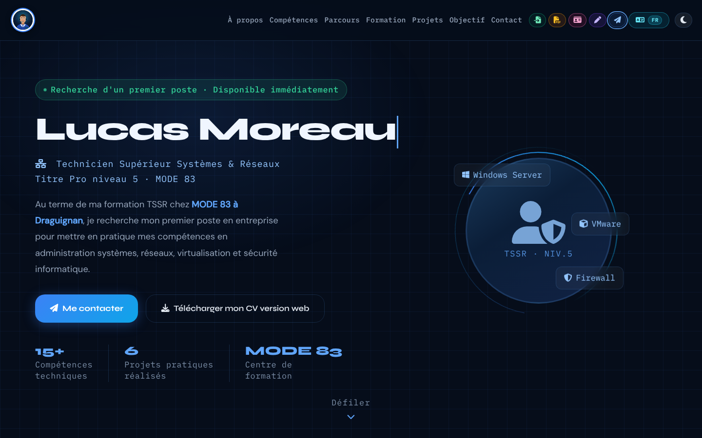

Page unique (`index.html`), sans framework ni étape de build, construite en **20 épisodes** dans le cadre de la formation TSSR de MODE 83. Chaque ligne du code est commentée en français pour servir de support pédagogique.

> ℹ️ **Lucas Moreau est un profil d'exemple.** Le nom, les coordonnées, le parcours et les projets sont des données fictives à remplacer par les vôtres (directement dans le code, ou via le **mode Éditer** et l'**import de CV PDF** décrits plus bas).

---

## Sommaire

- [Aperçu du contenu](#aperçu-du-contenu)
- [Fonctionnalités](#fonctionnalités)
- [Thème clair et version mobile](#thème-clair-et-version-mobile)
- [Structure des fichiers](#structure-des-fichiers)
- [Démarrage rapide](#démarrage-rapide)
- [Personnalisation](#personnalisation)
- [Mise en ligne sur GitHub Pages](#mise-en-ligne-sur-github-pages)
- [Les 20 épisodes](#les-20-épisodes)
- [Technologies utilisées](#technologies-utilisées)
- [Accessibilité et qualité](#accessibilité-et-qualité)
- [Données enregistrées dans le navigateur](#données-enregistrées-dans-le-navigateur)
- [Crédits](#crédits)

---

## Aperçu du contenu

La page se compose d'une barre de navigation, d'un écran d'accueil, de sept sections numérotées et d'un pied de page.

### Navigation

Logo `LM.` (remplaçable par une photo de profil circulaire) · liens **À propos · Compétences · Parcours · Formation · Projets · Objectif · Contact** · boutons d'outils **Éditer · PDF A4 · CV PDF · CV 1 page · Formspree · Traduire** · bascule **Mode clair / sombre**. Menu burger sous 992 px, navbar sur une seule ligne au-delà (boutons compacts « icône seule » entre 992 et 1 599 px).

### Hero — écran d'accueil

- Badge : *Recherche d'un premier poste · Disponible immédiatement*
- Nom en **effet machine à écrire** : **Lucas Moreau**
- Titre : *Technicien Supérieur Systèmes & Réseaux* — *Titre Pro niveau 5 · MODE 83*
- Boutons : **Me contacter** · **Télécharger mon CV version web**
- Compteurs animés : **15+** compétences techniques · **6** projets pratiques réalisés · **MODE 83** centre de formation
- Étiquettes flottantes : *TSSR · NIV.5 · Windows Server · Firewall · VMware* · indicateur « Défiler »

### 01 — À propos de moi · *Profil & motivations*

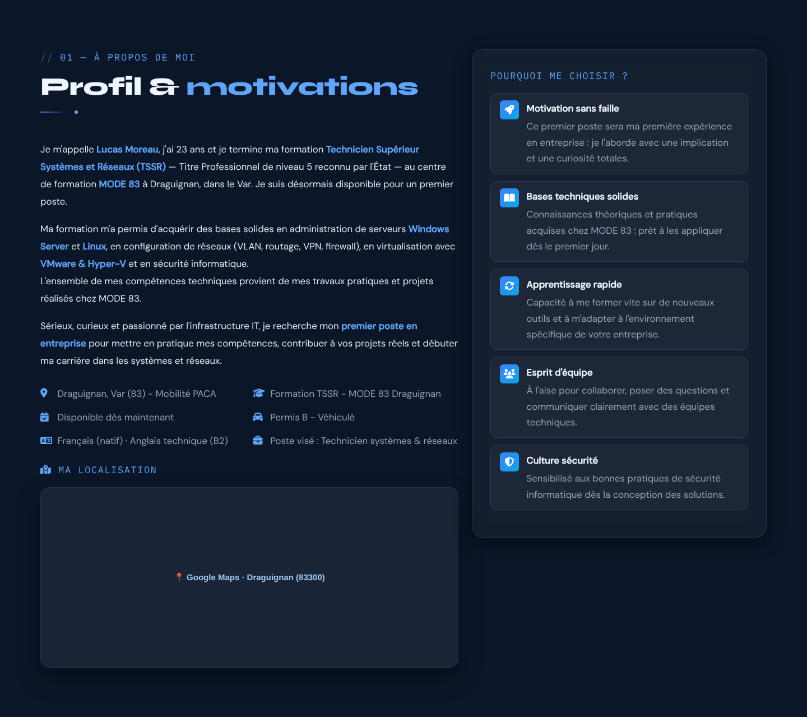

Lucas Moreau, 23 ans, termine sa formation TSSR chez MODE 83 : administration **Windows Server** et **Linux**, réseaux (VLAN, routage, VPN, firewall), virtualisation **VMware & Hyper-V**, sécurité informatique.

| Information | Valeur |
|---|---|
| Localisation | Draguignan, Var (83) – Mobilité PACA |
| Formation | TSSR – MODE 83 Draguignan |
| Disponibilité | Dès maintenant |
| Mobilité | Permis B – Véhiculé |
| Langues | Français (natif) · Anglais technique (B2) |
| Poste visé | Technicien systèmes & réseaux |

Carte Google Maps intégrée (Draguignan, 83300) et encart **« Pourquoi me choisir ? »** : Motivation sans faille · Bases techniques solides · Apprentissage rapide · Esprit d'équipe · Culture sécurité.

### 02 — Compétences · *Stack technique*

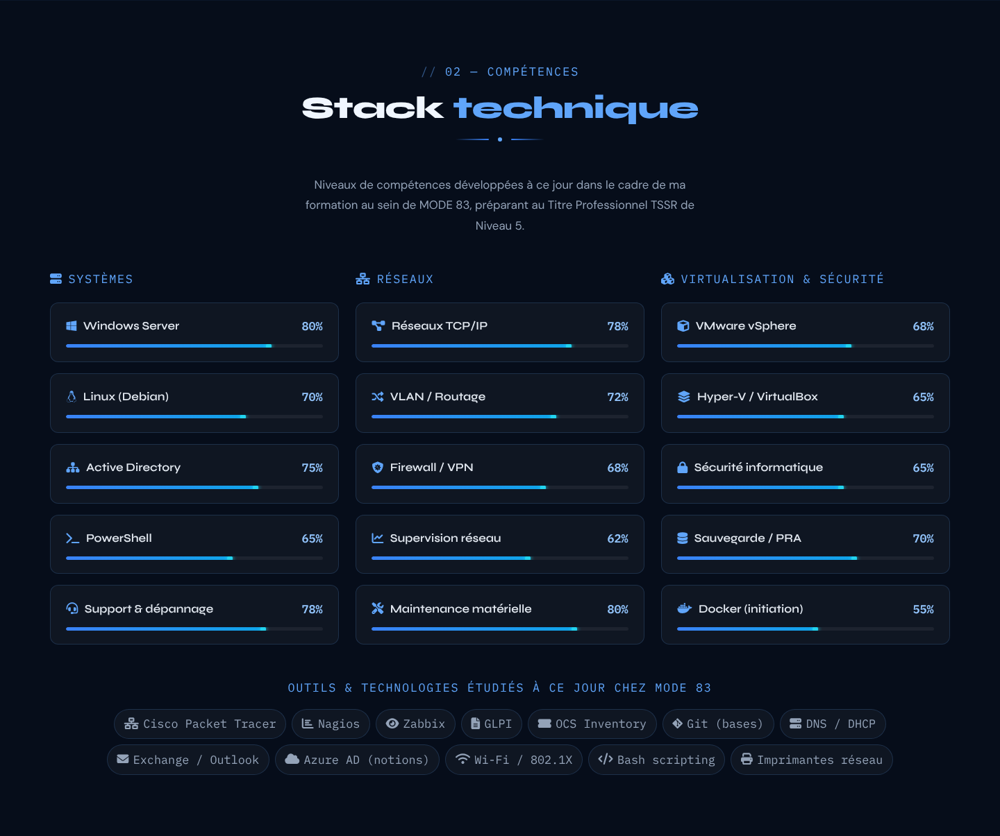

Barres de progression animées à l'apparition à l'écran :

| Systèmes | | Réseaux | | Virtualisation & Sécurité | |
|---|---|---|---|---|---|
| Windows Server | 80 % | Réseaux TCP/IP | 78 % | VMware vSphere | 68 % |
| Linux (Debian) | 70 % | VLAN / Routage | 72 % | Hyper-V / VirtualBox | 65 % |
| Active Directory | 75 % | Firewall / VPN | 68 % | Sécurité informatique | 65 % |
| PowerShell | 65 % | Supervision réseau | 62 % | Sauvegarde / PRA | 70 % |
| Support & dépannage | 78 % | Maintenance matérielle | 80 % | Docker (initiation) | 55 % |

**Outils & technologies étudiés chez MODE 83 :** Cisco Packet Tracer · Nagios · Zabbix · GLPI · OCS Inventory · Git (bases) · DNS / DHCP · Exchange / Outlook · Azure AD (notions) · Wi-Fi / 802.1X · Bash scripting · Imprimantes réseau.

### 03 — Parcours · *Formation & parcours scolaire*

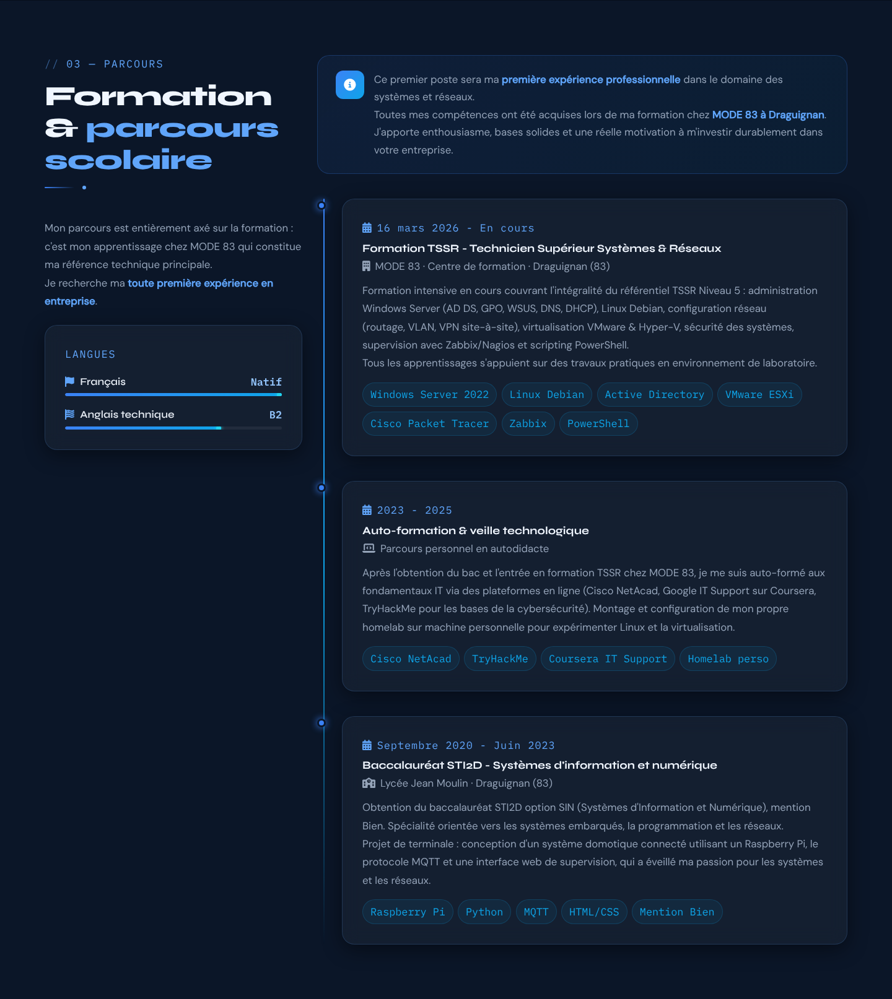

Encart **Langues** (Français natif · Anglais technique B2) et frise chronologique :

| Période | Étape | Mots-clés |
|---|---|---|
| 16 mars 2026 – en cours | **Formation TSSR** – MODE 83, Draguignan : Windows Server (AD DS, GPO, WSUS, DNS, DHCP), Linux Debian, routage, VLAN, VPN site-à-site, VMware & Hyper-V, supervision Zabbix/Nagios, PowerShell — en laboratoire | Windows Server 2022 · Linux Debian · Active Directory · VMware ESXi · Cisco Packet Tracer · Zabbix · PowerShell |
| 2023 – 2025 | **Auto-formation & veille technologique** : Cisco NetAcad, Google IT Support (Coursera), TryHackMe, homelab personnel | Cisco NetAcad · TryHackMe · Coursera IT Support · Homelab perso |
| Sept. 2020 – juin 2023 | **Baccalauréat STI2D option SIN**, mention Bien – Lycée Jean Moulin, Draguignan. Projet de terminale : domotique connectée (Raspberry Pi, MQTT, supervision web) | Raspberry Pi · Python · MQTT · HTML/CSS · Mention Bien |

### 04 — Formation · *Certification & compétences acquises*

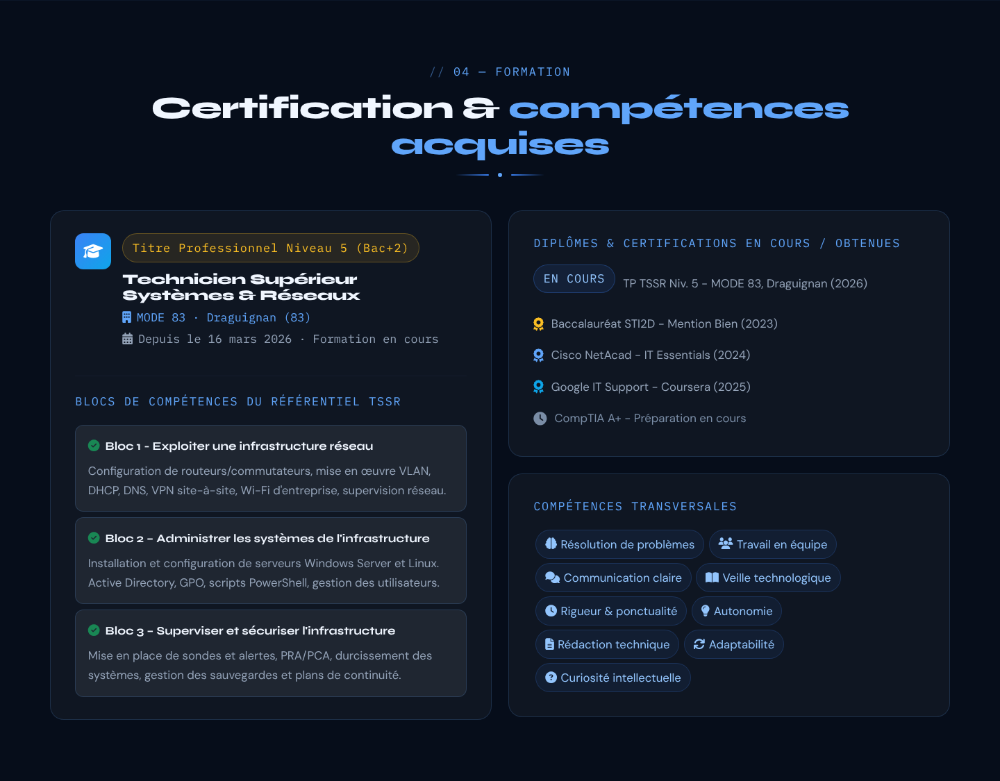

**Titre Professionnel Niveau 5 (Bac+2) – Technicien Supérieur Systèmes & Réseaux** · MODE 83, Draguignan · depuis le 16 mars 2026.

Blocs de compétences du référentiel TSSR :

1. **Exploiter une infrastructure réseau** — routeurs/commutateurs, VLAN, DHCP, DNS, VPN site-à-site, Wi-Fi d'entreprise, supervision réseau.
2. **Administrer les systèmes de l'infrastructure** — Windows Server et Linux, Active Directory, GPO, scripts PowerShell, gestion des utilisateurs.
3. **Superviser et sécuriser l'infrastructure** — sondes et alertes, PRA/PCA, durcissement, sauvegardes et plans de continuité.

Diplômes & certifications : TP TSSR Niv. 5 – MODE 83 (2026, **en cours**) · Baccalauréat STI2D – Mention Bien (2023) · Cisco NetAcad – IT Essentials (2024) · Google IT Support – Coursera (2025) · CompTIA A+ – préparation en cours.

Compétences transversales : Résolution de problèmes · Travail en équipe · Communication claire · Veille technologique · Rigueur & ponctualité · Autonomie · Rédaction technique · Adaptabilité · Curiosité intellectuelle.

### 05 — Projets · *Applications & outils .exe*

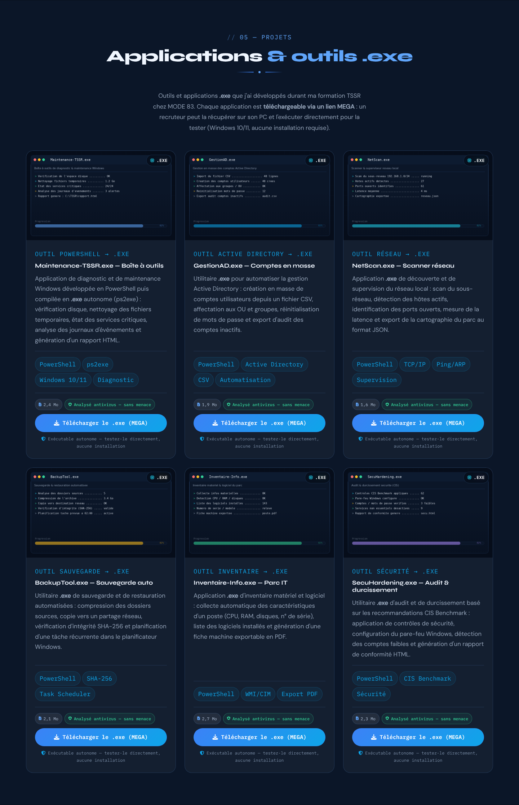

Six outils PowerShell compilés en `.exe` autonomes (Windows 10/11, sans installation), chacun avec capture d'écran agrandissable, taille, mention *« Analysé antivirus — sans menace »* et bouton **Télécharger le .exe (MEGA)** :

| Capture | Outil | Rôle | Technologies | Taille |
|---|---|---|---|---|
| 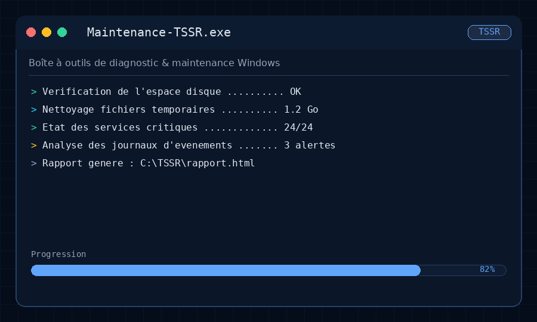 | **Maintenance-TSSR.exe** — Boîte à outils | Vérification disque, nettoyage des fichiers temporaires, services critiques, journaux d'événements, rapport HTML | PowerShell · ps2exe · Windows 10/11 · Diagnostic | 2,4 Mo |
| 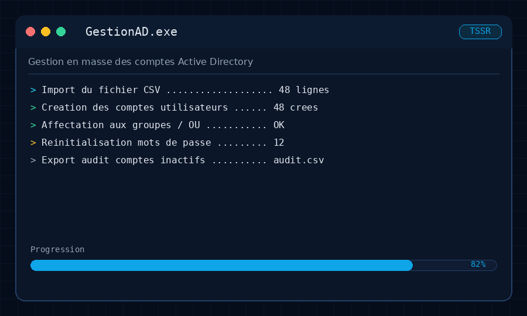 | **GestionAD.exe** — Comptes en masse | Création de comptes AD depuis un CSV, OU et groupes, réinitialisation de mots de passe, audit des comptes inactifs | PowerShell · Active Directory · CSV · Automatisation | 1,9 Mo |
| 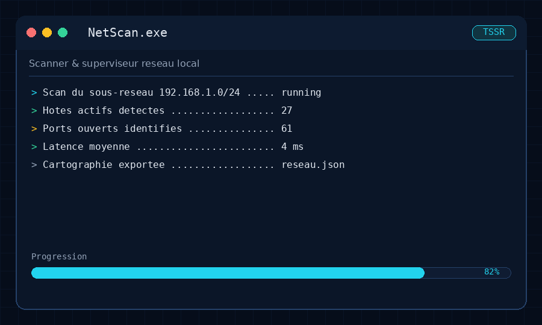 | **NetScan.exe** — Scanner réseau | Scan du sous-réseau, hôtes actifs, ports ouverts, latence, cartographie exportée en JSON | PowerShell · TCP/IP · Ping/ARP · Supervision | 1,6 Mo |
| 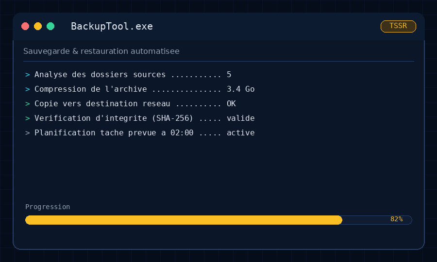 | **BackupTool.exe** — Sauvegarde auto | Compression, copie vers un partage réseau, contrôle d'intégrité SHA-256, tâche planifiée | PowerShell · SHA-256 · Task Scheduler | 2,1 Mo |
| 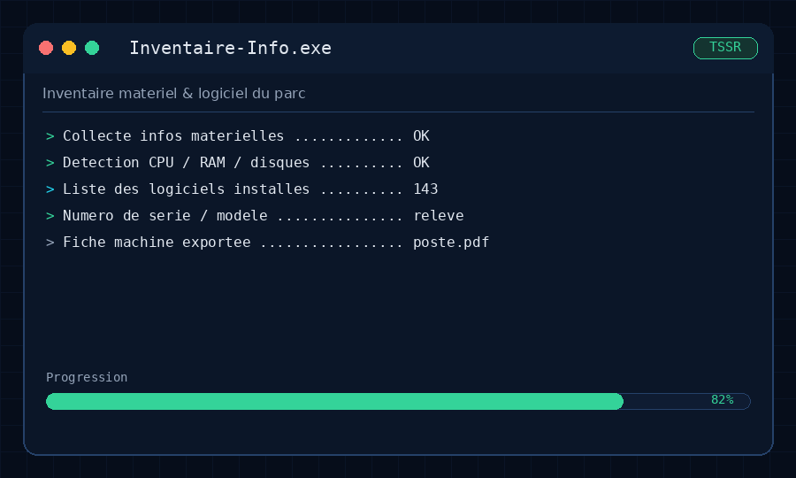 | **Inventaire-Info.exe** — Parc IT | CPU, RAM, disques, n° de série, logiciels installés, fiche machine en PDF | PowerShell · WMI/CIM · Export PDF | 2,7 Mo |
| 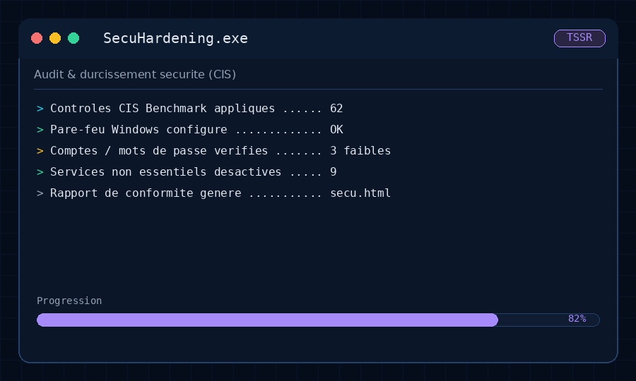 | **SecuHardening.exe** — Audit & durcissement | Contrôles CIS Benchmark, pare-feu Windows, comptes faibles, rapport de conformité HTML | PowerShell · CIS Benchmark · Sécurité | 2,3 Mo |

### 06 — Objectif professionnel · *Mon premier poste en entreprise*

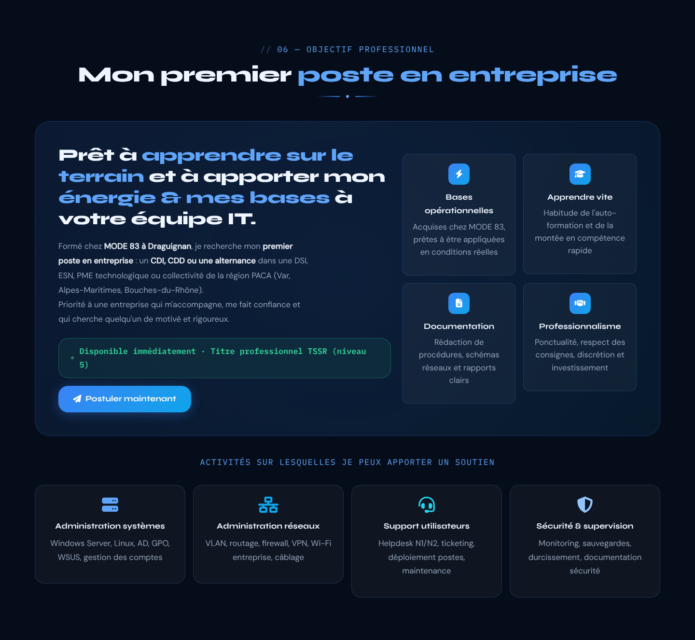

Recherche d'un **CDI, CDD ou d'une alternance** dans une DSI, ESN, PME technologique ou collectivité de la région PACA (Var, Alpes-Maritimes, Bouches-du-Rhône). Bouton **Postuler maintenant**.

- Atouts : Bases opérationnelles · Apprendre vite · Documentation · Professionnalisme
- Activités de soutien : **Administration systèmes** (Windows Server, Linux, AD, GPO, WSUS) · **Administration réseaux** (VLAN, routage, firewall, VPN, Wi-Fi, câblage) · **Support utilisateurs** (helpdesk N1/N2, ticketing, déploiement, maintenance) · **Sécurité & supervision** (monitoring, sauvegardes, durcissement, documentation)

### 07 — Contact · *Travaillons ensemble*

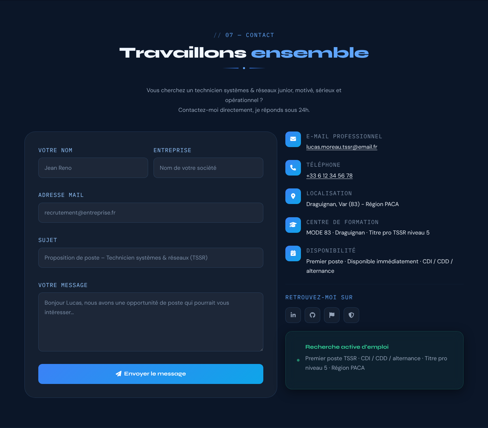

Formulaire **Votre nom · Entreprise · Adresse mail · Sujet · Votre message**, validé côté client et envoyé sans rechargement via **Formspree**, avec messages de succès et d'erreur.

Coordonnées affichées : `lucas.moreau.tssr@email.fr` · +33 6 12 34 56 78 · Draguignan, Var (83) – Région PACA · MODE 83 (titre pro TSSR niveau 5) · Premier poste, disponible immédiatement (CDI / CDD / alternance). Réseaux : LinkedIn · GitHub · Root-Me.

### Pied de page

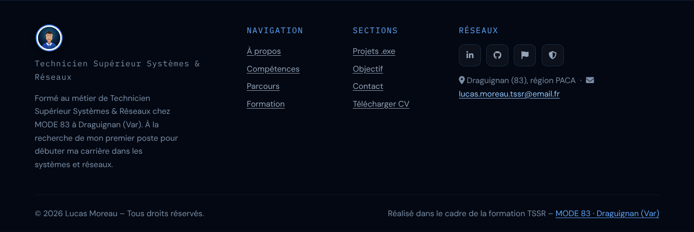

Logo, présentation courte, liens **Navigation** et **Sections** (dont *Projets .exe* et *Télécharger CV*), réseaux sociaux, lien vers le site de MODE 83, mention *« Réalisé dans le cadre de la formation TSSR – MODE 83 · Draguignan (Var) »*.

---

## Fonctionnalités

### Interface

- 🌗 **Thème sombre / clair** mémorisé, avec anti-clignotement au chargement
- ⌨️ **Effet machine à écrire** sur le nom et **compteurs animés** dans le Hero
- 📊 **Barres de compétences** et **apparitions au défilement** (`IntersectionObserver`)
- 📍 **Lien actif** du menu selon la section visible, fermeture automatique du menu mobile
- 📏 **Barre de lecture** en haut de l'écran
- ⬆️ **Bouton retour en haut** avec anneau de progression et **sons Web Audio** générés par le navigateur (aucun fichier MP3) : « propulsion » au clic, son d'arrivée en haut de page
- 🔔 **Toasts** de notification lus par les lecteurs d'écran
- 🖼️ **Visionneuse des captures** des projets : flèches, Échap, zoom taille réelle (1 800 px), tactile, piège du focus

### Outils de la barre de navigation

| Bouton | Fonction |
|---|---|
| **Éditer** | Mode édition : les textes de la page deviennent modifiables directement (bandeau « Mode édition actif »). Le nom saisi est conservé au rechargement. |
| **Photo** *(en mode Éditer)* | Remplace le logo `LM.` par une photo circulaire (recadrage carré automatique), propose de la retirer ou de **télécharger `photo-profil.jpg`** prêt à mettre en ligne. |
| **PDF A4** | Exporte le portfolio complet au format A4 via l'impression du navigateur, avec une feuille de style d'impression dédiée. |
| **CV PDF** | **Importe un CV PDF** par glisser-déposer : PDF.js extrait le texte, un analyseur heuristique adapté aux CV français remplit automatiquement la page. **100 % local** : le fichier ne quitte jamais l'ordinateur. |
| **CV 1 page** | Génère un **CV premium tenant sur une seule page A4**, en mode clair haute lisibilité (police Atkinson Hyperlegible, contrastes AAA, texte sélectionnable), à partir du contenu *actuel* de la page (y compris après édition ou import), photo incluse. Aussi accessible depuis le bouton du Hero et le lien du pied de page. |
| **Formspree** | Ouvre la fenêtre de configuration de la clé Formspree (voir ci-dessous). Raccourci **Ctrl + Maj + F**. Le bouton passe au vert quand une clé est active. |
| **Traduire** | Traduit toute la page (y compris modales, toasts, `placeholder`, `title`, `alt`, `aria-label`) en **FR · EN · ES · DE · IT · PT · NL** via Google Traduction. Le choix de langue est mémorisé. |

### Les outils en images

| Mode Éditer | Import d'un CV PDF |
|---|---|
| 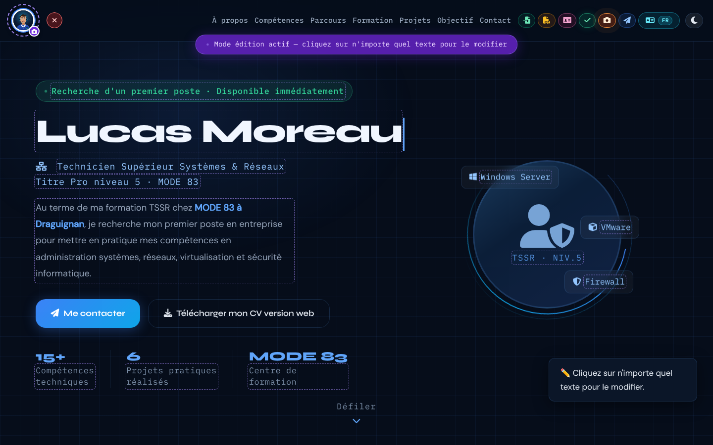 | 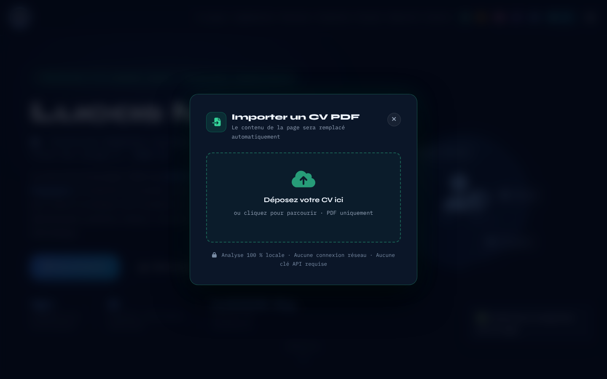 |
| **CV 1 page A4** | **Clé Formspree** |
| 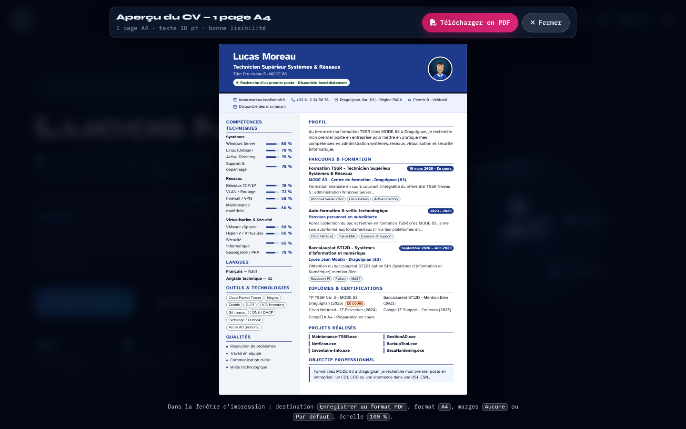 | 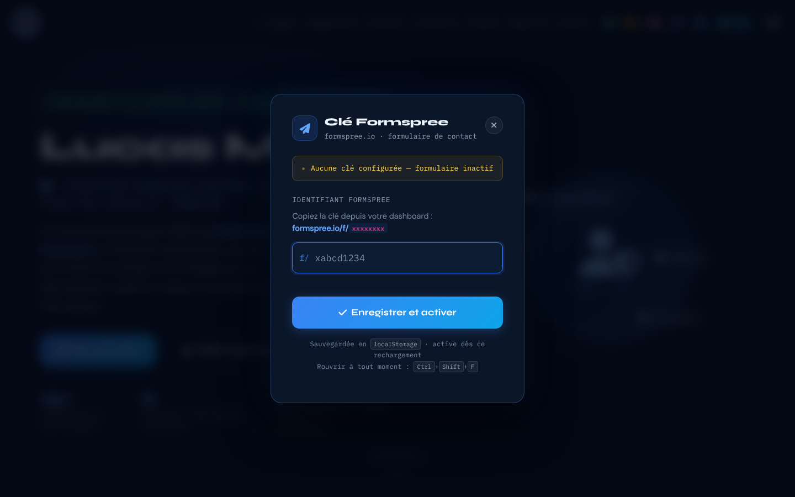 |
| **Visionneuse des captures** | |
| 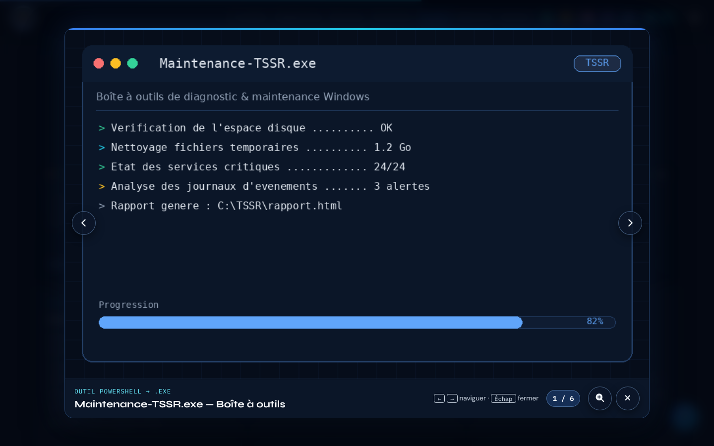 | |

---

## Thème clair et version mobile

| Thème clair — accueil | Thème clair — compétences |
|---|---|
| 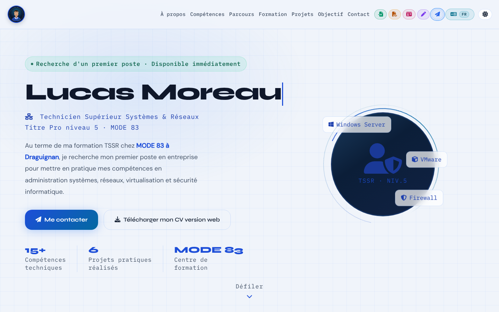 | 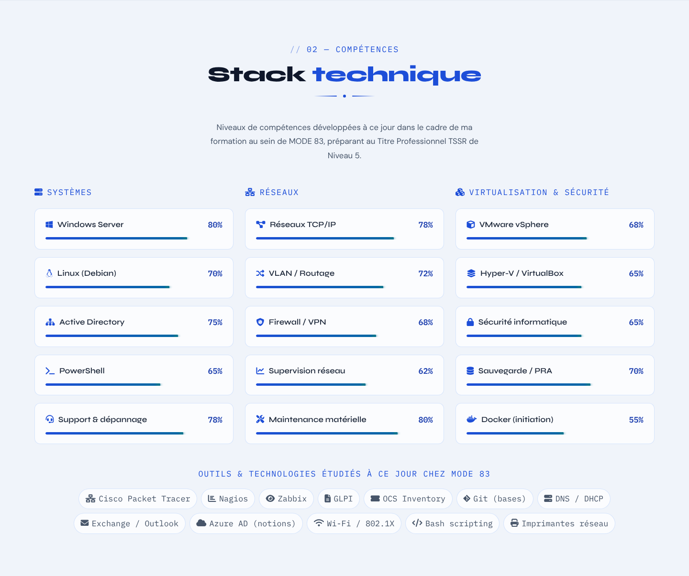 |

<p align="center">
  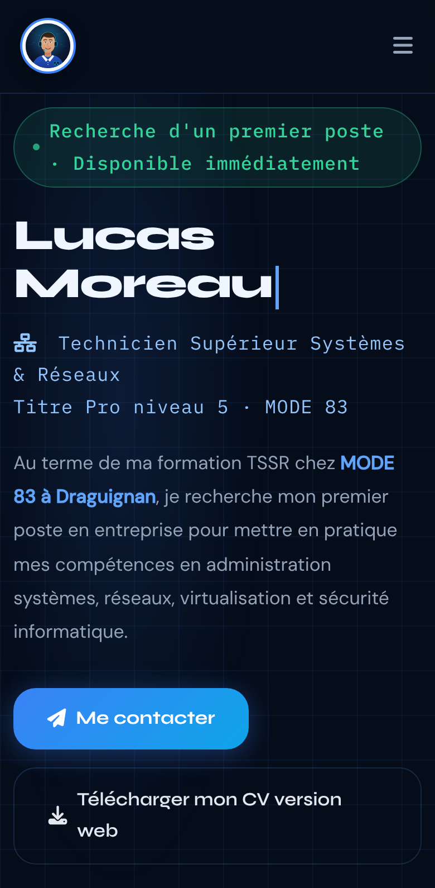
  &nbsp;&nbsp;
  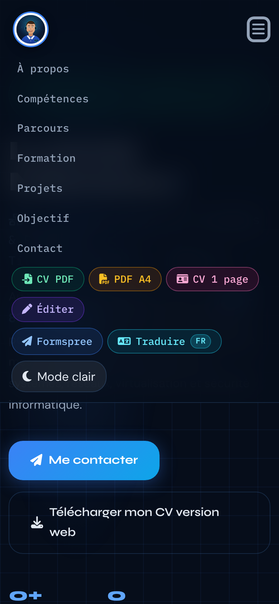
</p>

---

## Structure des fichiers

```
portfolio-tssr-vf/
├── index.html              # La page complète : HTML, CSS et JavaScript commentés
├── config.js               # Fenêtre de configuration de la clé Formspree
├── photo-profil.jpg        # Photo de profil (640 × 640)
├── docs/
│   └── screenshots/        # Captures d'écran utilisées dans ce README (18 images)
└── images/
    ├── favicon.png               # Favicon 400 × 400
    ├── favicon-32x32.png
    ├── favicon-192x192.png
    ├── favicon-400x400.webp
    ├── apple-touch-icon.png      # 180 × 180
    ├── photo-profil (1).jpg      # Copie de la photo de profil
    └── exe-1.png … exe-6.png     # Captures des six outils (900 × 540)
```

> ⚠️ **Photo de profil :** le code lit la photo en ligne à l'adresse `images/photo-profil.jpg` (réglage `PHOTO_FILE`). Dans l'archive, la photo se trouve à la racine (`photo-profil.jpg`) et sous le nom `images/photo-profil (1).jpg`. Pour qu'elle s'affiche chez tous les visiteurs, placez-la dans `images/` sous le nom exact **`photo-profil.jpg`** (attention aux majuscules et minuscules sur GitHub Pages).

---

## Démarrage rapide

Aucune installation n'est nécessaire.

1. Décompressez l'archive.
2. Ouvrez `index.html` par **double-clic** (`file://`) ou avec l'extension **Live Server / Go Live** de VS Code.
3. À la première visite, la fenêtre **Clé Formspree** s'ouvre : saisissez votre identifiant pour activer le formulaire, ou fermez-la avec Échap.

Une connexion Internet est requise pour les ressources chargées depuis les CDN (Bootstrap, Font Awesome, Animate.css, Google Fonts, PDF.js), la carte, la traduction et l'envoi du formulaire.

---

## Personnalisation

### 1. Le contenu du CV

Trois méthodes, à combiner librement :

- **Dans le code** : modifiez les textes de `index.html` section par section (les commentaires indiquent le rôle de chaque ligne).
- **Mode Éditer** : cliquez sur *Éditer*, modifiez les textes à l'écran, puis exportez avec *PDF A4* ou *CV 1 page*.
- **Import CV PDF** : déposez votre CV PDF pour remplir automatiquement la page.

> Les modifications faites dans le navigateur ne changent pas le fichier `index.html` (seuls le nom et l'aperçu de la photo sont mémorisés localement). Pour une mise en ligne, reportez vos changements dans le code.

### 2. Le formulaire de contact (Formspree)

1. Créez un formulaire gratuit sur [formspree.io](https://formspree.io) et copiez son identifiant (la partie après `formspree.io/f/`).
2. Soit vous remplacez l'identifiant d'exemple `xpwpbvjz` dans `index.html` (3 occurrences) ;
3. Soit vous le saisissez dans la fenêtre **Formspree** (bouton de la navbar ou **Ctrl + Maj + F**) : `config.js` l'enregistre dans le `localStorage` et redirige automatiquement les envois vers votre compte. Une clé valide (au moins 8 caractères alphanumériques) est enregistrée dès la saisie et la fenêtre se ferme seule.

### 3. Les liens de téléchargement des `.exe`

Remplacez les six adresses `https://mega.nz/file/REMPLACER-PAR-VOTRE-LIEN-1` à `-6` par vos liens MEGA, et les captures `images/exe-1.png` à `exe-6.png` par les vôtres (format conseillé : 900 × 540).

### 4. Les réseaux sociaux

Dans la section Contact et dans le pied de page, remplacez les `href="#"` des liens **LinkedIn**, **GitHub** et **Root-Me** par vos profils.

### 5. Les métadonnées

Adaptez dans le `<head>` : `<title>`, `description`, `keywords`, `author` et les favicons du dossier `images/`.

---

## Mise en ligne sur GitHub Pages

1. Créez un dépôt public et envoyez-y le contenu du dossier `portfolio-tssr-vf/` (avec `index.html` à la racine).
2. Dans **Settings → Pages**, choisissez la branche `main` et le dossier `/ (root)`.
3. Le portfolio est publié à l'adresse `https://<votre-pseudo>.github.io/<nom-du-depot>/`.

Les épisodes intermédiaires du cours sont publiés selon le même principe : `https://lugo795.github.io/cv-portfolio-tssr-episode-N/`.

---

## Les 20 épisodes

Le code est découpé et annoté selon les épisodes du cours (repères `ÉPISODE NN` dans les commentaires).

| Ép. | Contenu |
|---|---|
| 01 | Squelette HTML5 : `<head>`, métadonnées SEO, polices, CDN, `config.js` (squelette) et PDF.js |
| 02 | Feuille de style interne, variables de couleurs, lien d'évitement « Passer au contenu principal » |
| 03 | Barre de navigation, menu burger, conteneur des toasts, JavaScript de Bootstrap |
| 04 | Section Hero, effet machine à écrire, compteurs animés |
| 05 | Styles communs des sections, À propos, apparitions au défilement, lien actif, fermeture du menu mobile |
| 06 | Compétences et barres de progression |
| 07 | Parcours (frise chronologique) |
| 08 | Formation (et correctif du lien actif) |
| 09 | Projets `.exe` |
| 10 | Objectif professionnel |
| 11 | Contact, formulaire AJAX Formspree, contenu complet de `config.js` |
| 12 | Pied de page, bouton retour en haut, correctifs issus d'un audit Lighthouse |
| 13 | Barre de lecture |
| 14 | Récapitulatif des modules JavaScript 5 à 12 |
| 15 | Mode édition, export PDF A4, interface d'import de CV |
| 16 | Import automatique d'un CV PDF avec PDF.js |
| 17 | Sons Web Audio du bouton retour en haut |
| 18 | Traduction multilingue FR · EN · ES · DE · IT · PT · NL |
| 19 | CV PDF premium sur une seule page A4 |
| 20 | Version finale contrôlée |

**Correctifs de la version finale** (repérés `CORRECTIF` dans le code) :

1. Lien actif du menu : classe `.active` au lieu d'un style écrasé par `!important`
2. Puce du badge `.exe` : taille héritée du badge
3. Captures `.exe` entières : rapport 900/540 au lieu d'une hauteur fixe
4. Réduction des animations : `prefers-reduced-motion` respecté
5. Débordement horizontal : `overflow-x: clip` sur `html` et `body`
6. Contrastes du thème clair : niveau WCAG AA atteint

**Ajouts après l'épisode 20 :** visionneuse des captures de projets, anti-clignotement au changement de thème, photo de profil circulaire dans le logo (bouton *Photo*), photo de profil sur le CV 1 page.

---

## Technologies utilisées

| Technologie | Version | Usage |
|---|---|---|
| HTML5 / CSS3 / JavaScript | — | Page unique, JavaScript vanilla en modules auto-exécutés (IIFE) |
| [Bootstrap](https://getbootstrap.com) | 5.3.0 | Grille, navbar responsive (bundle avec Popper) |
| [Font Awesome](https://fontawesome.com) | 6.4.0 | Icônes |
| [Animate.css](https://animate.style) | 4.1.1 | Animations |
| [PDF.js](https://mozilla.github.io/pdf.js/) | 3.11.174 | Lecture locale des CV PDF importés |
| Google Fonts | — | **Syne** (titres), **IBM Plex Mono** (code, libellés), **DM Sans** (texte), **Atkinson Hyperlegible** (CV 1 page) |
| [Formspree](https://formspree.io) | — | Envoi du formulaire de contact |
| Google Traduction (widget) | — | Traduction de la page |
| Google Maps (iframe) | — | Carte de localisation |
| Web Audio API | — | Sons synthétisés du bouton retour en haut |

---

## Accessibilité et qualité

- Lien d'évitement, structure sémantique, sections reliées à leurs titres par `aria-labelledby`
- `aria-label` sur tous les boutons et liens à icône seule, zones `aria-live` pour les toasts et retours de formulaire
- Barre de lecture `role="progressbar"`, fenêtres modales `role="dialog"` avec piège du focus et retour du focus à l'élément d'origine
- Navigation complète au clavier (Tab, Entrée, Échap, flèches, **Ctrl + Maj + F**)
- Contrastes **WCAG AA** en thème clair, CV 1 page en contrastes **AAA**
- Respect de `prefers-reduced-motion`
- Styles d'impression dédiés (outils et fenêtres masqués à l'impression)
- Correctifs issus d'un audit **Lighthouse**

---

## Données enregistrées dans le navigateur

Le portfolio ne dispose d'aucun serveur. Quelques réglages sont conservés dans le `localStorage` du visiteur :

| Clé | Contenu |
|---|---|
| `theme` | Thème clair ou sombre choisi |
| `portfolio_lang` | Langue de traduction choisie |
| `_formspree_key` | Identifiant Formspree saisi dans la fenêtre de configuration |
| `portfolio_custom_name` | Nom modifié en mode Éditer |
| `portfolio_brand_photo` | Aperçu local de la photo de profil (navigateur de l'auteur uniquement) |

---

## Crédits

Projet pédagogique réalisé dans le cadre de la formation **Technicien Supérieur Systèmes et Réseaux** (Titre Professionnel niveau 5, RNCP 37682) au **[Centre de Formation MODE 83](https://mode83.net/site/)**, Draguignan (Var).

Conception du support de cours : **Jean-Claude Lugo**, formateur expert — MODE 83.

© Lucas Moreau (profil d'exemple) – Tous droits réservés.
